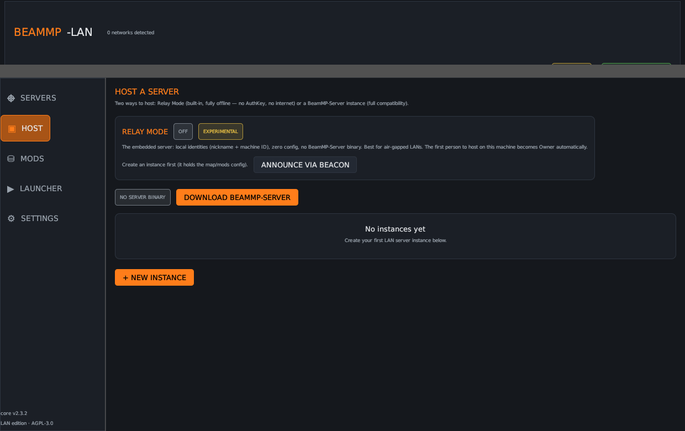
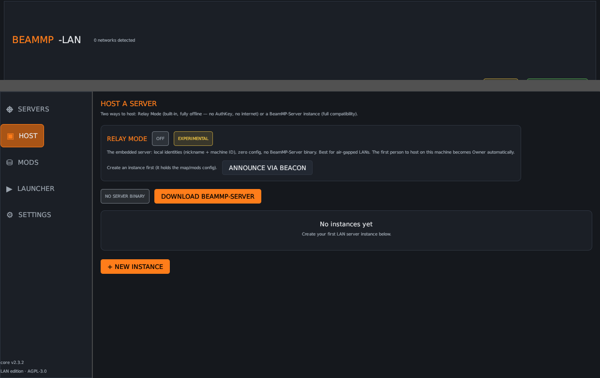
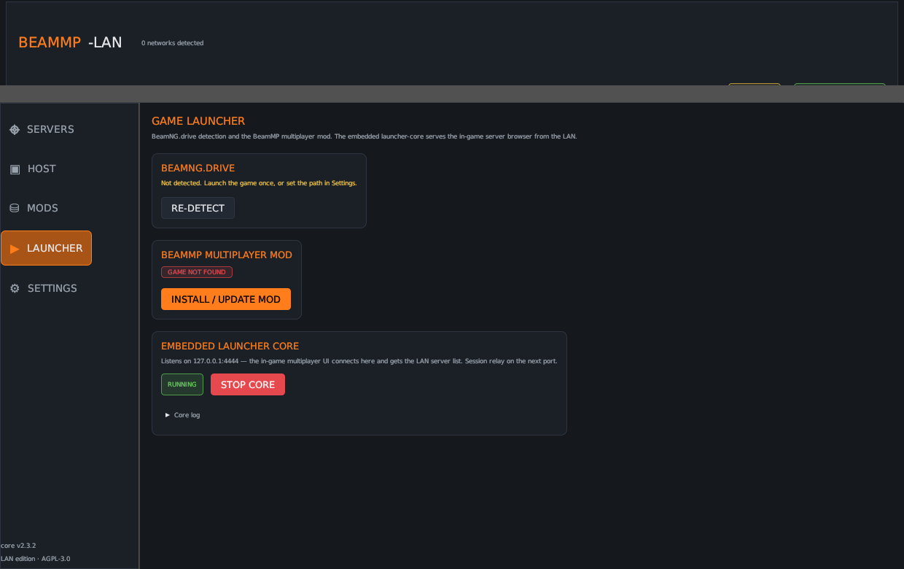
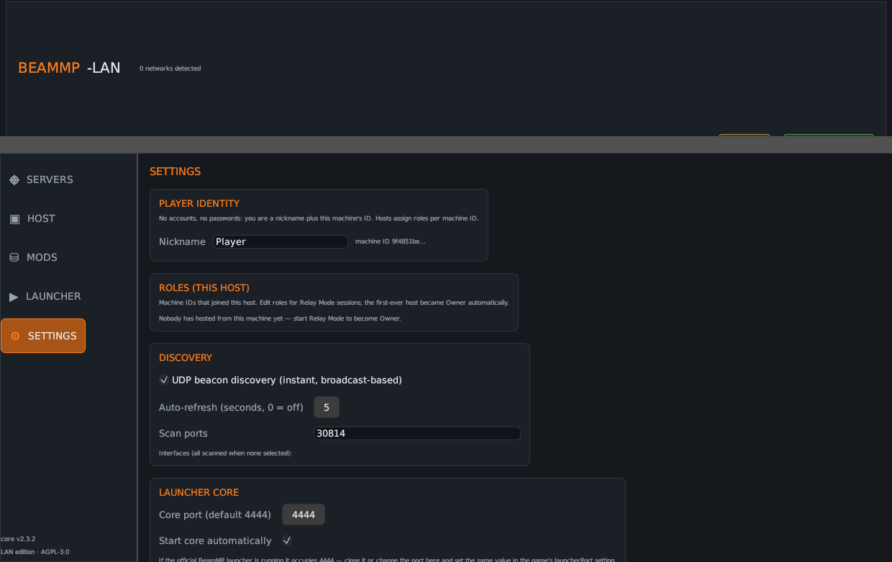
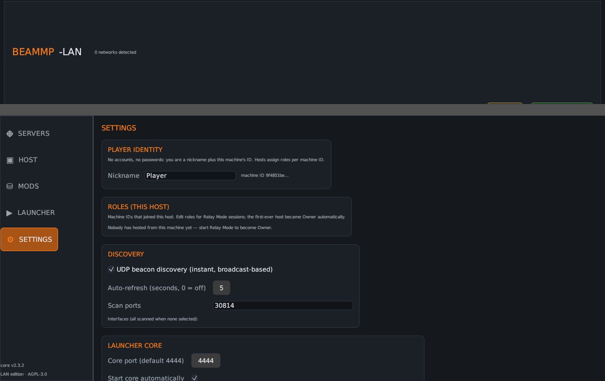

<div align="center">


# BeamMP-LAN

**The all-in-one LAN companion for BeamMP** — server manager, mod manager, game launcher
and LAN server browser in a single native app.

*Built for LAN parties and VPN LANs: Radmin VPN · ZeroTier · Tailscale · Hamachi · plain ethernet*

[](https://www.rust-lang.org)
[](LICENSE)
[](https://github.com/Pxrvlz/BeamMP-LAN/releases)

</div>

---

## What is this?

BeamMP's official toolchain is built around the internet: the server registers with
`backend.beammp.com`, the launcher pulls the public server list from the backend, and
discovery only works through the master list. On a LAN — or a VPN LAN like
Radmin — you don't want any of that.

**BeamMP-LAN** is one native Rust app (no browser, no Electron) that replaces the whole
toolchain for local play:

| Page | What it does |
| --- | --- |
| **SERVERS** | Discovers BeamMP servers on every connected network — instantly via **UDP LAN beacon** (hosts announce on :30816), with the TCP subnet scan (`'I'` packet on :30814) as fallback. No internet involved. One-click join, favorites, manual `IP:port` entries. |
| **HOST** | Two ways to host: **Relay Mode** (embedded server — fully offline, local identities, no AuthKey, experimental) or **BeamMP-Server instances** (full compatibility): download the official binary, create instances, edit `ServerConfig.toml` with a friendly UI, live console, start/stop/restart. One-click **CobaltEssentials** plugin install. |
| **MODS** | Manages each instance's `Resources/Client` (mods pushed to players) and `Resources/Server` (Lua plugins): install from `.zip`, enable/disable (`.zip.disabled`), SHA-256 hashes, protected-mod awareness via `mods.json`. Relay Mode serves the same folders. |
| **LAUNCHER** | Finds your BeamNG.drive install (registry / Steam / Linux paths), installs or updates the BeamMP mod into `mods/multiplayer/beammp.zip`, launches the game — and runs an **embedded launcher-core** that the in-game multiplayer UI connects to. |
| **SETTINGS** | **Player identity** (nickname + machine ID — the whole account system), host-side **roles editor** (Owner/Admin/Moderator/Player/Guest), discovery tuning (beacon toggle, interfaces, ports), launcher-core port, about. |

The embedded launcher-core is the special sauce: it implements the BeamMP launcher's
localhost protocol (`127.0.0.1:4444` core, `:4445` proxy relay, guest login, mod sync)
so the **in-game server browser shows your LAN servers** and joining works exactly like
with the official launcher — minus the internet dependency for the server list.

### Offline capability — the honest matrix

| Capability | Relay Mode | BeamMP-Server instance |
| --- | --- | --- |
| Discover servers | ✅ offline (beacon + scan) | ✅ offline (beacon + scan) |
| Host a session | ✅ offline | ✅ offline (after one-time AuthKey fetch) |
| Join a session | ✅ offline | ✅ offline (client auth is server-side) |
| Serve client mods | ✅ offline | ✅ offline |
| Install BeamMP mod (first time) | ❌ needs internet once | ❌ needs internet once |
| Full game-session fidelity | ⚠️ experimental | ✅ production |

Relay Mode is labeled experimental for a reason: its handshake, identity, mod sync and
frame fan-out are verified by scripted e2e tests, but real BeamNG clients exercise more
protocol surface. For a full evening of racing, prefer a BeamMP-Server instance; for an
air-gapped LAN, try Relay Mode and report what works.

## Screenshots

| Servers | Host |
| --- | --- |
|  |  |

| Mods | Launcher | Settings |
| --- | --- | --- |
|  |  |  |

The UI follows BeamNG.drive's design language: deep graphite panels, the signature
orange accent, thin light-blue selection outlines, uppercase headers and status pills.

## Getting started

### Requirements

* Windows 10/11 or Linux (the game itself is Windows/Linux)
* [BeamNG.drive](https://www.beamng.com) installed (for joining)
* An AuthKey from [keymaster.beammp.com](https://keymaster.beammp.com) (free, needed once
  to host — the BeamMP server refuses to start without one)

### Run a release build

Grab a build from [Releases](https://github.com/Pxrvlz/BeamMP-LAN/releases), or build
from source:

```bash
cargo build --release
# binary: target/release/beammp-lan[.exe]
```

### Host your first LAN server

1. Open BeamMP-LAN → **HOST** → *DOWNLOAD BEAMMP-SERVER* (fetches the official binary).
2. `+ NEW INSTANCE` — name, port, map, player limits; paste your AuthKey.
3. **START**. Watch the console; the top bar shows the address your friends should use.
4. Make sure the port (default `30814/tcp`) is allowed through your firewall
   (`New-NetFirewallRule -DisplayName BeamMP-LAN -Direction Inbound -LocalPort 30814 -Protocol TCP -Action Allow`
   on Windows, or allow it in your VPN tool's filter).

### Join from the same network

1. **LAUNCHER** → *INSTALL / UPDATE MOD* (one-time; needs internet for the mod download).
2. **LAUNCH GAME** (or press **JOIN** on a server card — the app launches the game).
3. In-game: `Play` → `Multiplayer` → the server list now contains your LAN servers —
   they're marked `LAN` in the location field. Direct connect to `26.x.x.x:30814` also
   works.

> If the official BeamMP launcher is running, close it first — it occupies port 4444.

## How discovery works

The app enumerates all IPv4 interfaces (`26.x` Radmin, `25.x` Hamachi/Radmin,
`100.x` Tailscale, `192.168.x`/`10.x` LANs…), scans each subnet for open TCP **30814**
in parallel, and sends the BeamMP info packet (`'I'`) to every open port. Servers reply
with `i32 LE length + JSON` (name, map, players, version, mods…). That JSON is the same
body the server normally heartbeats to the BeamMP backend — no internet needed here.
Large subnets are capped at the local /24; add hosts manually if your LAN uses a wider
mask.

Protocol details were derived from the actual BeamMP sources and are documented in
[docs/PLAN.md](docs/PLAN.md#5-protocol-research-verified-against-source).

## Building & tests

```bash
cargo build            # debug build
cargo test             # 30 unit tests incl. beacon + relay e2e (loopback)
cargo test -- --ignored # + wire-protocol E2E (needs scripts/e2e_protocol_test.py's fake server)
cargo clippy --all-targets  # lint (CI runs this at -D warnings)
cargo fmt              # format
```

The wire-protocol E2E drives a fake BeamMP server: `python3 scripts/e2e_protocol_test.py`
(repo root). The beacon and relay e2e tests run self-contained on loopback.

## Project layout

```
src/
  main.rs           entry point + generated app icon
  theme.rs          BeamNG-style dark theme tokens & widgets
  net.rs            BeamMP wire protocol: info packets, ping, framing
  beacon.rs         UDP LAN beacon: announce / seek / reply discovery
  identity.rs       local identity (nickname + machine ID) + role table
  relay.rs          Relay Mode: embedded offline BeamMP-speaking server
  discovery.rs      interface enumeration + TCP subnet scanning
  server_mgr.rs     server instances, ServerConfig.toml, process control
  mod_manager.rs    Resources/Client + Resources/Server mod management
  launcher.rs       game detection, BeamMP mod download, game launch
  launcher_core.rs  embedded launcher: 4444 core, proxy relay, guest login
  state.rs          app state, config persistence, event pump
  app.rs            the five UI pages
docs/PLAN.md        design document, protocol research, claim→implementation audit
screenshots/        UI screenshots (generated via BEAMMP_LAN_SHOTS)
```

## Limitations & notes

* **BeamMP-Server instances**: the AuthKey (one-time, from
  [keymaster.beammp.com](https://keymaster.beammp.com)) and client authentication still
  touch BeamMP's services — that's baked into the stock server. Use **Relay Mode** when
  you need the hosting side fully offline (experimental, see the matrix above).
* **Relay Mode is experimental**: scripted e2e tests verify handshake, local auth, mod
  sync and frame fan-out; real-game session fidelity (position/vehicle sync nuances)
  is the next milestone. The UI labels it EXPERIMENTAL.
* Server console *commands* (kick, say…) need a stdin pipe to the server process;
  the console view currently shows output only (see PLAN §6.2 — on the roadmap).
* The launcher-core relay covers TCP + UDP vehicle data with the launcher's compression
  rules; exotic server plugins that change the protocol may need updates.
* BeamNG.drive itself is closed-source commercial software; this project is not
  affiliated with BeamNG Srl. or BeamMP Ltd. CobaltEssentials is © its authors and is
  downloaded on demand from its official releases, not bundled.

## License

[AGPL-3.0-or-later](LICENSE) — same license as BeamMP itself. Interoperates with
BeamMP-Server, BeamMP-Launcher and the BeamMP mod over their network protocols;
contains none of their source code. BeamMP is © BeamMP Ltd., BeamMP team and
contributors.

<div align="center">
<sub>Built for LAN parties. Share the folder, start the server, crash the cars.</sub>
</div>
